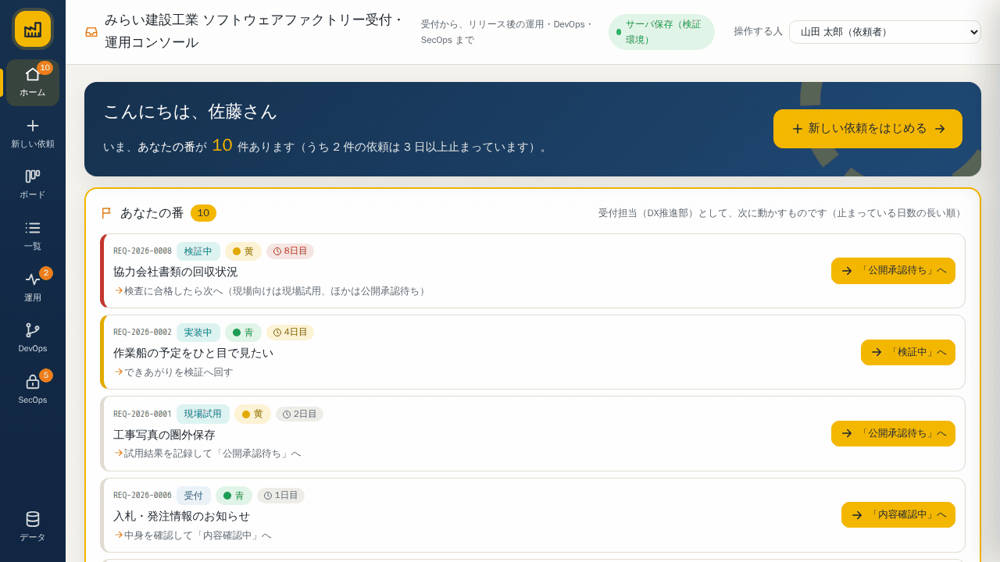
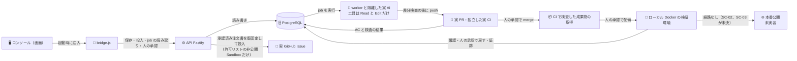

# 🏭 みらい建設工業 ソフトウェアファクトリー受付・運用コンソール

> **「現場の“困った”を、AIとCIが検査できる“注文書”に変える窓口」**
> 受付 → 信号の色 → 合格の条件 → 承認 → 注文書 → GitHub Issue まで、ひとつの流れで。

[](https://github.com/Kensan196948G/Software-Factory/actions)
[](package.json)
[](docs/database.md)
[](docs/deployment.md)
[](https://sf.mirai-dx-platform.com)



---

## ⏱️ 30秒でわかる

| 質問                | 答え                                                                                                                                    |
| ------------------- | --------------------------------------------------------------------------------------------------------------------------------------- |
| 🎯 **何をする？**   | 現場や部署の「困った」を1つの窓口で受け取り、**青・黄・赤の信号**と**合格の条件**を決めて、AIとCIがそのまま検査できる**注文書**に変える |
| 👤 **だれが使う？** | 依頼する人（現場・支店・本部）、受付担当（DX推進部）、承認者（業務責任者）。MVPは1人で3役を兼ねます                                     |
| 😫 **何が変わる？** | 「口頭・メール・Excelに散らばる要望」「検査できないあいまいな仕様」「追えない承認」を、**受付番号・状態・証跡**でそろえる               |
| 🚀 **どう動く？**   | 7ステップで登録 → 信号の色を自動で候補づけ → 承認者が決定 → 注文書YAML → **GitHub Issue** を自動作成                                    |
| 🔐 **安全？**       | 入口は Cloudflare Access（ワンタイムパスワード・12時間）。データはローカルPostgreSQL。監査ログはハッシュ連鎖                            |

> 🍽️ **たとえ**: レストランの「注文票」と同じです。お客さん（依頼者）が「これが食べたい」と言い、店長（承認者）が「これで作ります」と決め、厨房（開発ライン）が**注文票だけを見て**作ります。注文票が曖昧だと、出てくる料理もズレます。

---

## 💡 目的

> **システム開発要望の入口を1つにし、信号の色・合格の条件・承認を記録して、検査可能な注文書にする。**

もう少しやさしく言うと：

> **現場の「これ、どうにかならない？」を1か所で受け取り、**
> **「これは任せてOK（青）／人が確認（黄）／人は決めない（赤）」を見極め、**
> **「どうなれば合格か」を機械が判定できる言葉にして、**
> **開発の注文票（注文書）として渡す仕組みです。**

---

## 🚦 3つの流れ（メインFlow）

```
① 登録              ② 承認                    ③ 進める・見る
困りごとを書く  →   信号の色を決める    →   ボードで進み具合を見る
7ステップ           承認前チェック           差戻し→再提出
下書き自動保存      赤は「AIに決めさせない」   検索・CSV/JSON
```

| Flow     | 何をする                                                      | できあがるもの           |
| -------- | ------------------------------------------------------------- | ------------------------ |
| ① 登録   | 件名・困りごと・使う人・作るもの・合格の条件を7ステップで入力 | 受付番号 `REQ-2026-0001` |
| ② 承認   | 受付担当が整え、承認者が色を決定。△があれば確認               | 承認記録・注文書YAML     |
| ③ 進める | ボード/一覧/詳細で状態を進める。差戻し・見送り・取消も記録    | 監査ログ・証跡           |

---

## 🖥️ 画面（8ビュー）

| アイコン | 画面       | できること                                      |
| -------- | ---------- | ----------------------------------------------- |
| 🏠       | ホーム     | 「あなたの番」・件数・最近の動き                |
| ➕       | 新しい依頼 | 7ステップ入力・下書き・あいまい語の書き換え候補 |
| 📋       | ボード     | 状態ごとの列。カードから次へ                    |
| ☰       | 一覧       | 検索・絞り込み・CSV/JSON                        |
| ⚡       | 運用       | リリース後の道具・障害・バックアップ（見本）    |
| 🔀       | DevOps     | 開発ラインのIssue/PR/CI（見本）                 |
| 🔒       | SecOps     | 脆弱性・インシデント・監査（見本）              |
| 🗄️       | データ     | 保存先・書き出し・取り込み                      |

> 🎨 画面は `offline-Application/mirai-construction-sf-console.html` を**そのまま採用**しています（デザイン・文言・操作を統一）。

---

## 🔁 データの流れ

図の **実線は Staging の画面起点で実走を確認した経路**、**点線は未実装**です。既定の設定では fake のままで、実走には `DEVLINE_RUNNER_KIND=docker-claude` と許可リストの設定が要ります。



| 要素                                    | 状態                    | 中身                                                                                                                                   |
| --------------------------------------- | ----------------------- | -------------------------------------------------------------------------------------------------------------------------------------- |
| コンソール・bridge・API・DB             | 実走済み                | 受付の依頼はサーバに保存する                                                                                                           |
| 投入 → 実 Issue                         | 実走済み                | `POST /api/orders/:id/handoff`。未設定の環境と公開リポジトリでは「開発ライン未接続」と表示して送らない                                 |
| 隔離した実 AI → 実 PR → 独立した実 CI   | 実走済み（作り物 2 件） | 修正のやり直し、予算到達、禁止差分に実 AI が当たる場合は未走（`docs/devline/real-runner.md` 9 章）                                     |
| 人の承認 → merge → 成果物 → 配備 → 戻し | 実走済み（作り物 2 件） | 配備先はこのホストの内部ネットワークだけ。承認は 1 ユーザーの 3 役で、職務分離を満たさない。記録は `docs/devline/real-runner.md` 16 章 |
| 本番公開                                | 未実装                  | 経路を作っていない。認証の強化（PR #27）と本番基盤の決定が先                                                                           |
| 運用・DevOps・SecOps の数値             | 見本                    | 操作を確かめるための作り物。詳細の開発ライン欄で「見本」と書いた進み具合も同じで、実行していない                                       |

**画面の区別**: 開発ラインの各項目に「実行確認済み」「fake」「未接続」「見本」を文字で表示します。`runner_kind` と証跡の種別から機械的に決め、読めなかったものは未接続とします。

**見本で実依頼を進めません**: サーバに接続しているとき、AI 作業・CI 実行・PR 作成・マージ・配備の見本操作は実行できません。受付の状態は、受付担当と承認者がボードと状態変更ダイアログで進めます。投入しても受付の状態は変わりません。サーバに接続しない見本モードは、従来どおりブラウザの中だけで全工程を試せます。

---

## 📦 開発ラインに渡すもの（全部）

承認された依頼は、**7点セット**で GitHub Issue になります。
👉 詳細・実物・全項目は **[docs/development-line-handoff.md](docs/development-line-handoff.md)** に明記しています。

| #   | 渡すもの                | 中身                                                             |
| --- | ----------------------- | ---------------------------------------------------------------- |
| 1   | 📄 **注文書YAML**       | 何を・誰に・どこまで・合格の条件・制約・人に聞くこと（全28項目） |
| 2   | ✅ **承認記録**         | 承認者・決定した色・候補の色・承認前チェック・版・日時           |
| 3   | 🔢 **受付番号と版**     | `REQ-YYYY-NNNN` と `order_version`                               |
| 4   | 🎯 **合格の条件（AC）** | 検査できる言葉で1〜8件                                           |
| 5   | 🚧 **範囲と制約**       | 作るもの・今回は作らない・守ること・扱う情報                     |
| 6   | 🙋 **必ず人に聞くこと** | 安全・権限・外部接続など7区分                                    |
| 7   | 🔗 **受付へのリンク**   | 原本・履歴へ戻れるURL                                            |

**渡さないもの**: 添付の実体／個人情報・位置情報の実データ／図面・写真の原本／金額・原価／運用の見本データ。

---

## 🚀 クイックスタート

| 手順        | コマンド                                            | ひとこと                                 |
| ----------- | --------------------------------------------------- | ---------------------------------------- |
| 1️⃣ 依存関係 | `pnpm install`                                      | Node 22 / pnpm 10                        |
| 2️⃣ DB作成   | `createdb -O "$USER" mirai_sf_dev`                  | PostgreSQL 16                            |
| 3️⃣ 設定     | `node scripts/bootstrap-local.mjs`                  | 秘密情報は `~/.config/mirai-sf/`（0600） |
| 4️⃣ 初期化   | `pnpm db:migrate && pnpm db:seed && pnpm db:verify` | 19部署・118道具・見本9件                 |
| 5️⃣ 起動     | `pnpm dev`                                          | API 8781 / Web 5178                      |
| 6️⃣ ログイン | `http://127.0.0.1:5178`                             | 初期管理者は手順3で表示                  |

> 🔐 パスワードは `~/.config/mirai-sf/local.json` の `SEED_ADMIN_PASSWORD`。初回ログイン後に変更してください。

---

## ✅ 検証（実測）

単体、結合、E2E の数は PR #54 の CI の結果です。Docker は CI に入っていません。

| チェック                   | 結果                                     | コマンド                       |
| -------------------------- | ---------------------------------------- | ------------------------------ |
| 型チェック                 | ✅ PASS                                  | `pnpm typecheck`               |
| Lint                       | ✅ PASS（警告0）                         | `pnpm lint`                    |
| 単体テスト                 | ✅ 531 / 531                             | `pnpm test:unit`               |
| 結合テスト（実PostgreSQL） | ✅ 670 / 670                             | `pnpm test:integration`        |
| E2E（コンソールUI）        | ✅ 117 合格・1 skip（資格情報が要る1件） | `pnpm test:e2e`                |
| ビルド                     | ✅ PASS                                  | `pnpm build`                   |
| 秘密情報スキャン           | ✅ PASS                                  | `node scripts/secret-scan.mjs` |
| DB整合性                   | ✅ PASS                                  | `pnpm db:verify`               |
| CI（GitHub Actions）       | ✅ success                               | PRごと・main                   |
| 実 Docker の隔離の試験     | ✅ 21 / 21（CI 外、PR #48 の時点で実行） | `pnpm test:docker`             |

---

## 🧱 構成

```text
src/
  api/        ⚙️ Fastify API（認証・受付・承認・監査・Issue作成）
  shared/     🧠 ドメイン（信号・条件・遷移・注文書YAML・CSV）
  web/        🖥️ コンソール（原本 + bridge.js）
db/           🗄️ migration / seed（19部署・118道具・見本9件）
tests/        🧪 unit / integration / e2e
docs/         📚 設計・DB・API・テスト・デプロイ・制限・開発ライン連携
```

---

## 🔐 セキュリティ

| 項目            | 内容                                                                    |
| --------------- | ----------------------------------------------------------------------- |
| 🔑 認証         | ローカル=パスワード（scrypt）／Preview=Cloudflare Access（OTP・12時間） |
| 🛡️ 認可         | 役割は**サーバ側**で判定（画面の表示を信用しない）                      |
| 🚫 秘密情報     | リポジトリ・ログ・Seed・画面に置かない（`~/.config/mirai-sf/` 0600）    |
| 🧾 監査         | 追記のみ・ハッシュ連鎖・UPDATE/DELETEをトリガで拒否                     |
| 🌐 ネットワーク | ローカルDBは非公開。Tunnel経由のみ。CSP・CSRF・レート制限               |

---

## 🧩 既知の制限（MVP）

| #   | 制限                           | 影響                               |
| --- | ------------------------------ | ---------------------------------- |
| 1   | 1ユーザー・3役の切替           | 職務分離は本番のSSOまで待ち        |
| 2   | 下書きはブラウザ保存           | 端末を変えると続きから再開できない |
| 3   | 運用/DevOps/SecOpsの一部は見本 | 受付の注文書ではない               |
| 4   | 添付はメタ情報のみ             | 実体の保存・ウイルス検査はBacklog  |
| 5   | 通知なし                       | 承認依頼は画面で確認               |

詳細 → **[docs/limitations.md](docs/limitations.md)**

---

## 📚 ドキュメント

| 📄 ドキュメント                                          | 内容                                |
| -------------------------------------------------------- | ----------------------------------- |
| [初動Assessment](docs/project/00-assessment.md)          | 現状・Gap・環境                     |
| [MVP Scope](docs/project/01-mvp-scope.md)                | 何を作る／作らない                  |
| [Planning](docs/project/02-plan.md)                      | 計画・リスク・Rollback              |
| [WebUI設計](docs/project/03-design.md)                   | 画面の正・変更履歴                  |
| [データベース](docs/database.md)                         | テーブル・制約・バックアップ        |
| [API](docs/api.md)                                       | エンドポイント・エラー              |
| [テスト](docs/test.md)                                   | 実測結果・シナリオ                  |
| [デプロイ/復旧](docs/deployment.md)                      | Cloudflare・Tunnel・Access          |
| [開発ラインに渡すもの](docs/development-line-handoff.md) | **注文書・Issue・承認記録の全項目** |
| [既知の制限](docs/limitations.md)                        | 制限・残存リスク                    |
| [要件対応表](docs/requirements-trace.md)                 | FR/NFRとの対応                      |

---

<details>
<summary>❓ よくある質問（クリックで開く）</summary>

**Q. 信号の色はだれが決める？**
A. 候補は自動、決定は**承認者だけ**です。赤は「AIに決めさせない」確認が必要です。

**Q. 注文書はどこで見られる？**
A. 依頼の詳細 →「注文書（YAML）」タブ。コピー・ダウンロードできます。

**Q. Issue を2回作ったら？**
A. 2回目は作りません（`issue_no` で冪等）。既存の番号を返します。

**Q. 本番データは入る？**
A. 入りません。MVPは**作り物のデータだけ**です。

**Q. どこで動いている？**
A. `https://sf.mirai-dx-platform.com`（Cloudflare Access保護）。ローカルDBは非公開です。
</details>

---

## 📄 ライセンス

社内標準・社外秘（みらい建設工業株式会社）。第三者への公開はしません。
